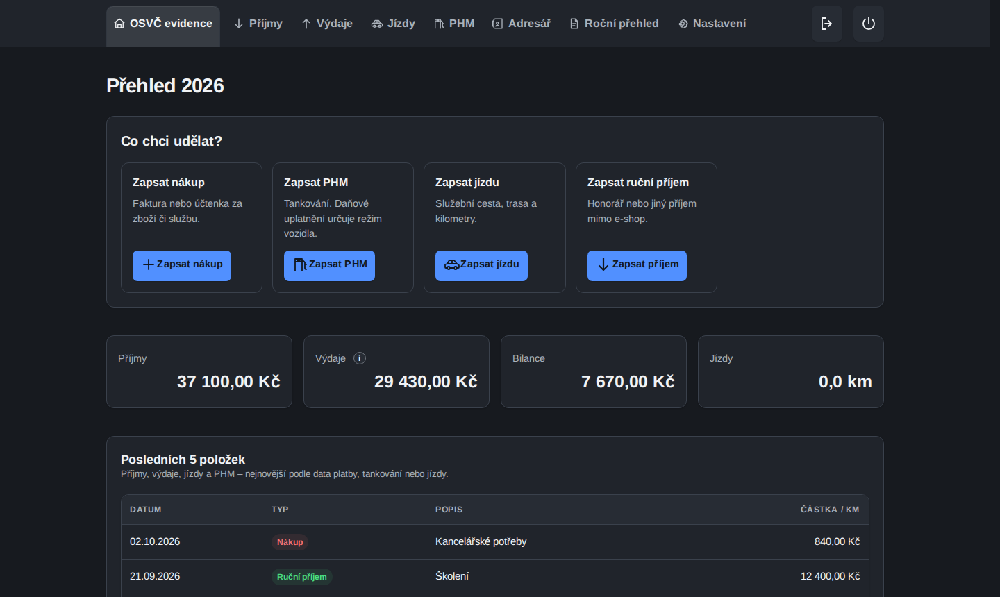
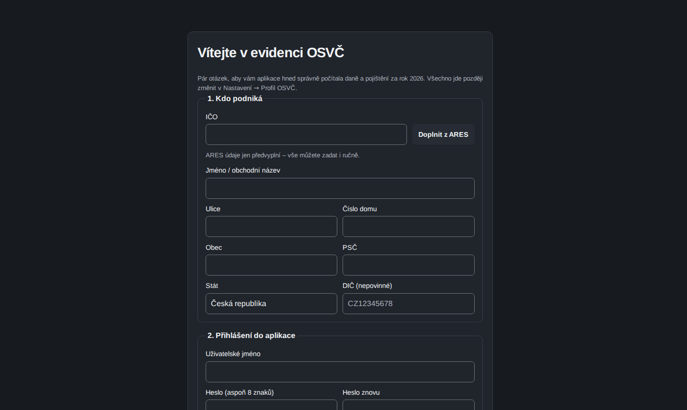
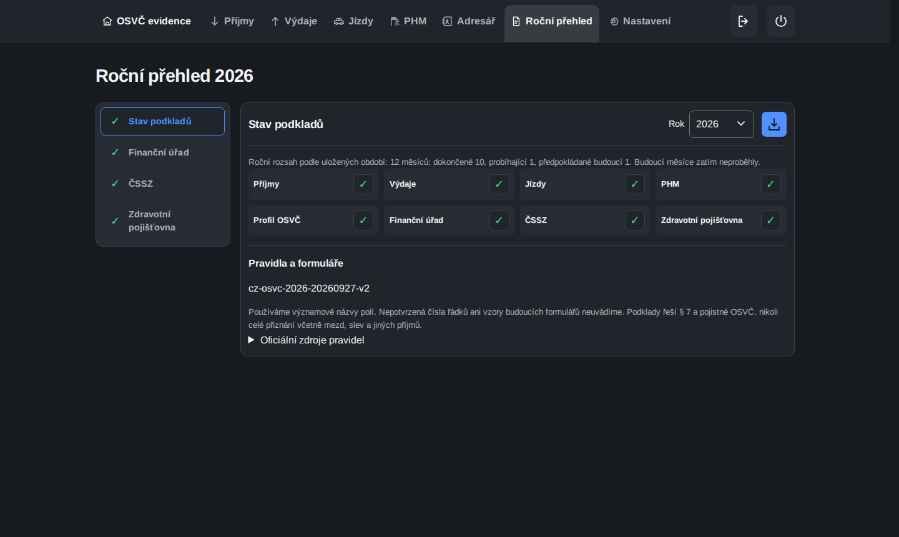
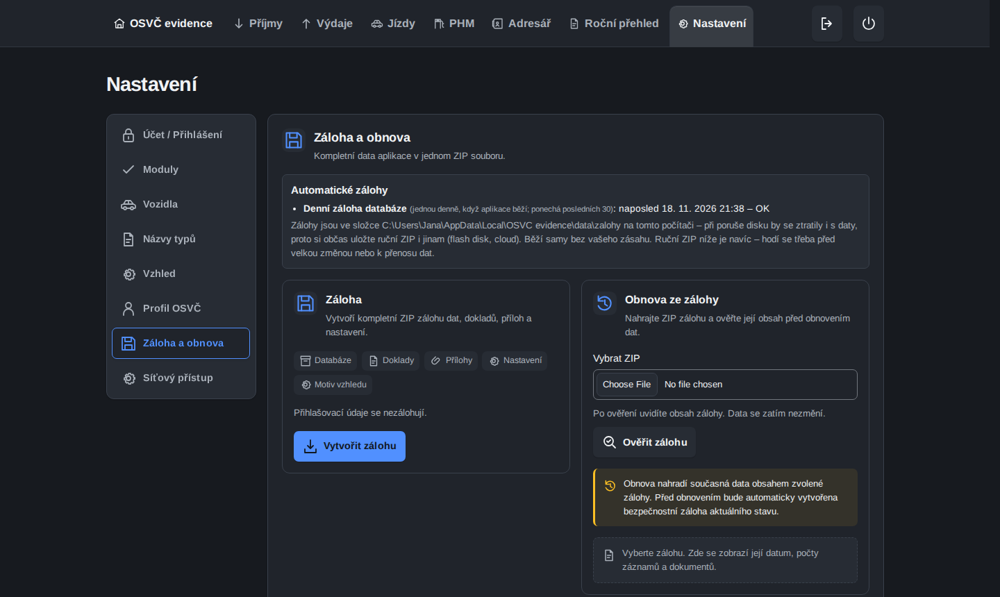

# OSVČ evidence

[](../../releases/latest/download/osvc-evidence-windows.exe)
[](../../releases/latest/download/osvc-evidence-linux.deb)

Všechny verze a popis změn: [Releases](../../releases)

OSVČ evidence – příjmy, výdaje, jízdy a Roční přehled pro daně, ČSSZ a zdravotní pojišťovnu. Windows a Linux.
Pro OSVČ – neplátce DPH. Data zůstávají jen u vás, rozhraní je česky.



## Co umí
- **Příjmy a výdaje** s doklady a přílohami, daňové posouzení výdajů, rychlé akce na Přehledu.
- **Jízdy a PHM** (modul Doprava): náhrady podle vyhláškových sazeb, tankování, vozidla a jejich daňový režim.
- **Roční přehled a Profil OSVČ:** vyměřovací základy, pojistné, zálohy a doplatky; stav podkladů zeleně / k doplnění.
- **Adresář** dodavatelů a odběratelů s doplněním z ARES.
- **Externí web** (volitelný modul): stahování zaplacených objednávek z e-shopu WooCommerce.
- **Zálohy:** denní automatická záloha a ruční ZIP záloha všech dat s kontrolou při obnově.
- **Síťový přístup:** jen tento počítač, nebo i mobil v domácí síti.

| Průvodce prvním spuštěním | Roční přehled |
|---|---|
|  |  |

## Instalace
Stáhněte poslední verzi tlačítkem nahoře, nebo z **[Releases](../../releases/latest)**.

**Windows 10 / 11** – `osvc-evidence-windows.exe` (totéž jako `osvc-evidence-X.Y.Z-windows.exe`)
- Instalace jen pro vašeho uživatele, **bez práv správce**. Po instalaci je v nabídce Start zástupce **OSVČ evidence**.
- Data: `%LOCALAPPDATA%\OSVC evidence` (mimo složku programu).

**Ubuntu 24.04+ / Debian 13+** – `osvc-evidence-linux.deb` (totéž jako `osvc-evidence_X.Y.Z_amd64.deb`)
```
sudo apt install ./osvc-evidence-linux.deb
```
- Běží jako služba `osvc-evidence`, zástupce je v nabídce aplikací. Data: `/var/lib/osvc-evidence`.

Aplikace se otevírá v prohlížeči na adrese `http://localhost:PORT/` (port vybere instalace sama, obvykle 8765).
Kontrolní součty souborů jsou v `SHA256SUMS.txt` u každého vydání.

## První spuštění
Průvodce se zeptá jen na to, co je potřeba ke správnému výpočtu: IČO (jméno a adresu doplní z ARES), přihlašovací jméno
a heslo, od kdy letos podnikáte, zaměstnání, zdravotní pojišťovnu, zálohy, způsob uplatnění výdajů a které části chcete
používat. Na druhé straně případně vozidlo a zdroj příjmů. Všechno jde později změnit v **Nastavení → Profil OSVČ**.

## Zálohy
- **Denní záloha** databáze proběhne sama, když aplikace běží (ponechá posledních 30).
- **ZIP záloha** všech dat, dokladů a nastavení: Nastavení → Záloha a obnova. Po obnově aplikace ukáže srovnávací tabulku.
- Zálohy jsou na stejném disku jako data – ZIP si proto občas uložte i jinam (flash disk, cloud).



## Aktualizace
Nová verze se instaluje **přes starou** (stejný instalátor / balíček) – data zůstanou. Před úpravou struktury databáze
aplikace sama uloží snímek a při chybě data vrátí. Jednou denně se aplikace podívá na GitHub, zda nevyšla nová verze,
a ukáže upozornění s odkazem (vypnete v Nastavení → Účet / Přihlášení → Aktualizace).

## Síťový přístup
Výchozí je **jen tento počítač**. V Nastavení → Síťový přístup jde aplikaci zpřístupnit v domácí síti (např. pro mobil).
Spojení není šifrované – používejte to jen doma. Windows přidá pravidlo firewallu jen pro port aplikace a soukromou síť;
na Linuxu aplikace firewall nemění.

## Odinstalace
- **Windows:** Nastavení → Aplikace (nebo zástupce v nabídce Start). Odinstalace se zeptá, zda **data ponechat** (výchozí),
  nebo je **smazat** – před smazáním nabídne ZIP zálohu na Plochu.
- **Linux:** `sudo apt remove osvc-evidence` odebere program a službu, data ponechá. `sudo apt purge osvc-evidence` smaže
  i data, předtím je uloží do `/var/backups/osvc-evidence`.

## Bezpečnost a soukromí
Data jsou jen na vašem počítači. Aplikace se připojuje ven jen do veřejného rejstříku ARES (na vyžádání), jednou denně
na GitHub kvůli nové verzi (vypnutelné) a k vašemu e-shopu, pokud zapnete modul Externí web.
Bezpečnostní chyby hlaste podle [SECURITY.md](SECURITY.md).

## Pro vývojáře
- Python 3.12+, Flask, databáze **SQLite** (schéma `sql/sqlite/schema.sql`, úpravy struktury `sql/sqlite/migrace/`).
- Spuštění: `python -m osvc_app.spoustec spust --config osvc.conf --data data --otevrit`.
- Testy: `bash tests/spust.sh --ci` (prázdná databáze ze schématu, seznam `tests/ci.txt`).
- Balíčky: `scripts/windows/sestav.py` (+ Inno Setup `osvc.iss`), `scripts/linux/sestav_deb.py`.
- Vydání: tag `vX.Y.Z` → GitHub Actions (`.github/workflows/vydani.yml`) otestuje, sestaví, vyzkouší instalaci,
  aktualizaci i odinstalaci a vytvoří Release s popisem z [CHANGELOG.md](CHANGELOG.md).

### Kde co je v kódu
Stránky jsou na blueprintu `main`, ostatní části mají vlastní blueprint.

| Oblast | Soubor |
|---|---|
| Přehled, platby (příjmy/výdaje), sdílené pomocné funkce (`login_required`, `audit`, výpočet cesty) | `osvc_app/routes.py` |
| Přihlášení, odhlášení, napájení | `osvc_app/system_routes.py` |
| Jízdy a PHM | `osvc_app/trips_fuel_routes.py` |
| Doklady a přílohy | `osvc_app/documents_routes.py` |
| Adresář a ověření v ARES | `osvc_app/address_routes.py` |
| Nastavení (moduly, vozidla, názvy typů, vzhled) | `osvc_app/settings_routes.py`, `moduly.py` |
| Akce / účel | `osvc_app/events_routes.py` |
| Zdroje příjmů (karta, přidání, ověření, synchronizace) | `osvc_app/income_source_routes.py`, `connectors.py`, `woocommerce.py`, `payment_settlement.py` |
| Roční přehled a Profil OSVČ | `osvc_app/annual_routes.py`, `annual.py`, `profile*.py` |
| Záloha a obnova ZIP | `osvc_app/backup_routes.py`, `backup.py` |
| Databáze: `query()`/`execute()` sdílí jedno spojení na požadavek, `connection()` = vlastní transakce | `osvc_app/db.py` |
| Český čas (uložené časy jsou UTC) | `osvc_app/cas.py` |

## Podepisování kódu (Code signing policy)
Instalátor pro Windows se podepisuje automaticky v GitHub Actions z kódu tohoto repozitáře – nic se nepodepisuje ručně
ani mimo sestavení. Podepisuje se jen vydání vytvořené z tagu `vX.Y.Z` po úspěšných testech.

Free code signing provided by [SignPath.io](https://about.signpath.io/), certificate by [SignPath Foundation](https://signpath.org/).
*(Platí po schválení přihlášky do SignPath Foundation.)*

- Autor a schvalovatel vydání (committer, reviewer, approver): vlastník repozitáře.
- Každé vydání musí výslovně schválit vlastník (vytvoření tagu).

**Ochrana soukromí (Privacy policy):** Aplikace neposílá žádná data jiným systémům, pokud o to uživatel sám nepožádá nebo
to výslovně nezapne: dotaz do veřejného rejstříku ARES (tlačítko „Doplnit z ARES“), synchronizace e-shopu (modul Externí web)
a jednou denně dotaz na novou verzi na GitHubu bez osobních údajů (vypnutelné v Nastavení).
This program will not transfer any information to other networked systems unless specifically requested by the user or the
person installing or operating it (ARES lookup on request, optional e-shop synchronisation, daily update check without personal
data that can be turned off in Settings).

## Licence
[EUPL-1.2](LICENSE) – Evropská veřejná licence EU. Oficiální znění je ve všech jazycích EU včetně češtiny:
<https://joinup.ec.europa.eu/collection/eupl/eupl-text-eupl-12>.
