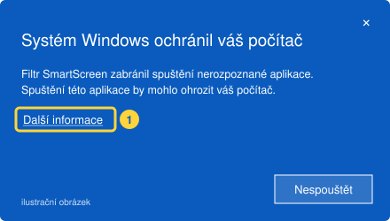
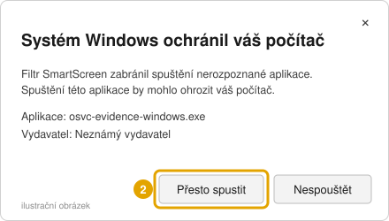

# OSVČ evidence

<p>
  <a href="../../releases/latest/download/osvc-evidence-windows.exe"></a>
  &nbsp;
  <a href="../../releases/latest/download/osvc-evidence-linux.deb"></a>
</p>

Všechny verze a popis změn: [Releases](../../releases) · [Code signing policy](#code-signing-policy)

Windows může při instalaci zobrazit varování – jak ho přeskočit, najdete v části [Instalace](#instalace).

OSVČ evidence – příjmy, výdaje, jízdy a Roční přehled pro daně, ČSSZ a zdravotní pojišťovnu. Windows a Linux.
Pro OSVČ – neplátce DPH. Data zůstávají jen u vás, rozhraní je česky.


## Co umí
- **Příjmy a výdaje** s doklady a přílohami, daňové posouzení výdajů, rychlé akce na Přehledu.
- **Jízdy a PHM** (modul Doprava): náhrady podle vyhláškových sazeb, tankování, vozidla a jejich daňový režim.
- **Roční přehled a Profil OSVČ:** podklady k opsání do přiznání a přehledů (PDF na 1 stranu), pojistné, zálohy a doplatky;
  příslušný finanční úřad, OSSZ a pojišťovna s datovou schránkou, formuláři a termíny podání.
- **Adresář** dodavatelů a odběratelů s doplněním z ARES.
- **Externí web** (volitelný modul): stahování zaplacených objednávek z e-shopu WooCommerce.
- **Zálohy:** denní automatická záloha a ruční ZIP záloha všech dat s kontrolou při obnově.
- **Síťový přístup:** jen tento počítač, nebo i mobil v domácí síti.

| Průvodce prvním spuštěním | Roční přehled |
|---|---|
|  |  |

## Instalace
Stáhněte poslední verzi tlačítkem nahoře, nebo z **[Releases](../../releases/latest)**.

**Windows 10 / 11** – `osvc-evidence-windows.exe`

> **Instalace ve Windows – upozornění**
>
> Windows při spuštění instalátoru může ukázat okno s nadpisem **„Systém Windows ochránil váš počítač“**.
> Klikněte na **„Další informace“** a pak na **„Přesto spustit“**.
>
>  
>
> Aplikace je nová a zatím nemá digitální podpis – ten se uděluje až rozšířenějším programům. Varování neznamená, že je program
> nebezpečný: zdrojový kód je veřejný a instalátor se sestavuje automaticky na GitHubu. Jakmile se program víc rozšíří, podpis
> doplníme a varování zmizí. Pro pokročilé: [kontrolní součty SHA256SUMS.txt](../../releases/latest/download/SHA256SUMS.txt).

- Instalace jen pro vašeho uživatele, **bez práv správce**. Po instalaci je v nabídce Start zástupce **OSVČ evidence**.
- Data: `%LOCALAPPDATA%\OSVC evidence` (mimo složku programu).

**Ubuntu 24.04+ / Debian 13+** – `osvc-evidence-linux.deb`
```
sudo apt install ./osvc-evidence-linux.deb
```
- Běží jako služba `osvc-evidence`, zástupce je v nabídce aplikací. Data: `/var/lib/osvc-evidence`.

Aplikace se otevírá v prohlížeči na adrese `http://localhost:PORT/` (port vybere instalace sama, obvykle 8765).
Kontrolní součty souborů jsou v `SHA256SUMS.txt` u každého vydání.

## První spuštění
Průvodce se zeptá jen na to, co je potřeba ke správnému výpočtu: IČO (jméno a adresu doplní z ARES), přihlašovací jméno
a heslo, od kdy letos podnikáte, zaměstnání, zdravotní pojišťovnu, zálohy, způsob uplatnění výdajů a které části chcete
používat. Na druhé straně případně vozidlo a zdroj příjmů. Všechno jde později změnit v **Nastavení → Profil OSVČ**.

## Zálohy
- **Denní záloha** databáze proběhne sama, když aplikace běží (ponechá posledních 30).
- **ZIP záloha** všech dat, dokladů a nastavení: Nastavení → Záloha a obnova. Po obnově aplikace ukáže srovnávací tabulku.
- Zálohy jsou na stejném disku jako data – ZIP si proto občas uložte i jinam (flash disk, cloud).


## Zapomenuté heslo
- **Záchranný kód:** při nastavení nebo změně hesla aplikace jednou ukáže záchranný kód (např. `K7QF-M2XD-9RTB`).
  Vytiskněte si ho nebo stáhněte jako .txt a uložte mimo počítač. Nový kód si můžete kdykoli vytvořit v Nastavení → Účet / Přihlášení.
  Na přihlašovací stránce klikněte na **Zapomněl jsem heslo**, zadejte kód a nastavte si nové jméno a heslo.
- **Bez kódu, přímo na počítači s aplikací:** Windows – nabídka Start → **OSVČ evidence – obnovit heslo**;
  Linux – `sudo osvc-evidence obnovit-heslo`. Pak se **na tomto počítači** přihlaste jako `osvc` / `osvc`
  (přes síť to nejde) a aplikace hned vyžádá nové jméno a heslo.
- Data, doklady ani nastavení se při obnově nemění. Po obnově se odhlásí všechna zařízení.

## Aktualizace
Nová verze se instaluje **přes starou** (stejný instalátor / balíček) – data zůstanou. Před úpravou struktury databáze
aplikace sama uloží snímek a při chybě data vrátí. Jednou denně se aplikace podívá na GitHub, zda nevyšla nová verze,
a ukáže upozornění s odkazem (vypnete v Nastavení → Účet / Přihlášení → Aktualizace).

## Síťový přístup
Výchozí je **jen tento počítač**. V Nastavení → Síťový přístup jde aplikaci zpřístupnit v domácí síti (např. pro mobil).
Spojení není šifrované – používejte to jen doma. Windows přidá pravidlo firewallu jen pro port aplikace a soukromou síť;
na Linuxu aplikace firewall nemění.

## Odinstalace
- **Windows:** Nastavení → Aplikace (nebo zástupce v nabídce Start). Odinstalace se zeptá, zda **data ponechat** (výchozí),
  nebo je **smazat** – před smazáním nabídne ZIP zálohu na Plochu.
- **Linux:** `sudo apt remove osvc-evidence` odebere program a službu, data ponechá. `sudo apt purge osvc-evidence` smaže
  i data, předtím je uloží do `/var/backups/osvc-evidence`.

## Bezpečnost a soukromí
Data jsou jen na vašem počítači. Aplikace se připojuje ven jen do veřejného rejstříku ARES (na vyžádání; adresu z Profilu OSVČ jednou kvůli určení příslušných úřadů v Ročním přehledu), jednou denně
na GitHub kvůli nové verzi (vypnutelné) a k vašemu e-shopu, pokud zapnete modul Externí web.
Bezpečnostní chyby hlaste podle [SECURITY.md](SECURITY.md).

## Pro vývojáře
- Python 3.12+, Flask, databáze **SQLite** (schéma `sql/sqlite/schema.sql`, úpravy struktury `sql/sqlite/migrace/`).
- Spuštění: `python -m osvc_app.spoustec spust --config osvc.conf --data data --otevrit`.
- Testy: `bash tests/spust.sh --ci` (prázdná databáze ze schématu, seznam `tests/ci.txt`).
- Balíčky: `scripts/windows/sestav.py` (+ Inno Setup `osvc.iss`), `scripts/linux/sestav_deb.py`.
- Vydání: tag `vX.Y.Z` → GitHub Actions (`.github/workflows/vydani.yml`) otestuje, sestaví, vyzkouší instalaci,
  aktualizaci i odinstalaci a vytvoří Release s popisem z [CHANGELOG.md](CHANGELOG.md).

### Kde co je v kódu
Stránky jsou na blueprintu `main`, ostatní části mají vlastní blueprint.

| Oblast | Soubor |
|---|---|
| Přehled, platby (příjmy/výdaje), sdílené pomocné funkce (`login_required`, `audit`, výpočet cesty) | `osvc_app/routes.py` |
| Přihlášení, odhlášení, napájení | `osvc_app/system_routes.py` |
| Jízdy a PHM | `osvc_app/trips_fuel_routes.py` |
| Doklady a přílohy | `osvc_app/documents_routes.py` |
| Adresář a ověření v ARES | `osvc_app/address_routes.py` |
| Nastavení (moduly, vozidla, názvy typů, vzhled) | `osvc_app/settings_routes.py`, `moduly.py` |
| Akce / účel | `osvc_app/events_routes.py` |
| Zdroje příjmů (karta, přidání, ověření, synchronizace) | `osvc_app/income_source_routes.py`, `connectors.py`, `woocommerce.py`, `payment_settlement.py` |
| Roční přehled a Profil OSVČ | `osvc_app/annual_routes.py`, `annual.py`, `profile*.py` |
| Záloha a obnova ZIP | `osvc_app/backup_routes.py`, `backup.py` |
| Databáze: `query()`/`execute()` sdílí jedno spojení na požadavek, `connection()` = vlastní transakce | `osvc_app/db.py` |
| Český čas (uložené časy jsou UTC) | `osvc_app/cas.py` |

## Code signing policy
*Zásady podepisování kódu.*

Free code signing provided by [SignPath.io](https://about.signpath.io/), certificate by [SignPath Foundation](https://signpath.org/).
*(Podpis instalátoru se zapne po schválení projektu SignPath Foundation.)*

Instalátor pro Windows se podepisuje automaticky v GitHub Actions z kódu tohoto repozitáře (`.github/workflows/vydani.yml`)
– nic se nepodepisuje ručně ani mimo toto sestavení. Podepisuje se jen vydání z tagu `vX.Y.Z` po úspěšných testech.

**Role v projektu (team roles)**
- Committers and reviewers – autoři a kontrola změn: vlastník repozitáře.
- Approvers – schvalování podpisu každého vydání: vlastník repozitáře.

Každé vydání musí vlastník výslovně schválit (vytvoření tagu a schválení podpisu v SignPath). Účet vlastníka má zapnuté
dvoufázové ověření.

### Privacy policy
*Zásady ochrany soukromí.*

This program will not transfer any information to other networked systems unless specifically requested by the user or the
person installing or operating it.

Aplikace neposílá vaše data jinam. Připojuje se jen v těchto případech:
- **ARES** – veřejný rejstřík Ministerstva financí ([ares.gov.cz](https://ares.gov.cz/)), jen když kliknete na „Doplnit z ARES“
  nebo hledáte firmu; posílá se jen zadané IČO nebo název.
- **GitHub – kontrola nové verze:** jednou denně se aplikace zeptá na poslední vydání tohoto repozitáře. Neposílá žádné vaše
  údaje (jen obecný identifikátor programu a číslo verze). **Vypnutí:** Nastavení → Účet / Přihlášení → Aktualizace → zrušte
  „Upozorňovat na nové verze“ a uložte. Platí zásady GitHubu:
  [GitHub General Privacy Statement](https://docs.github.com/site-policy/privacy-policies/github-general-privacy-statement).
- **Váš e-shop** – jen pokud zapnete modul Externí web a nastavíte zdroj příjmů (připojení k vašemu vlastnímu serveru).

Tyto informace ukazuje i instalátor pro Windows před instalací.

## Licence
[EUPL-1.2](LICENSE) – Evropská veřejná licence EU. Oficiální znění je ve všech jazycích EU včetně češtiny:
<https://joinup.ec.europa.eu/collection/eupl/eupl-text-eupl-12>.
